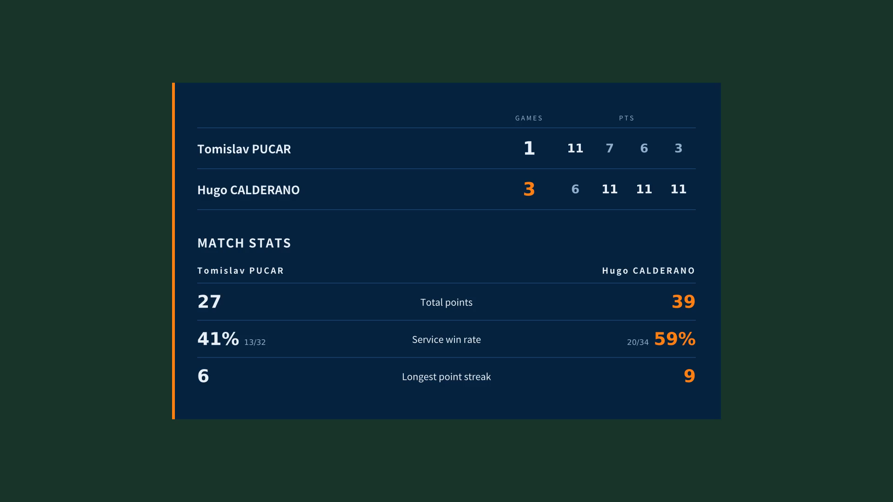

# ttcut

Turn raw table tennis footage into a tight, scored match video — cuts the ball-chasing, burns in a live scoreboard, and finishes on a match-summary card.

**English** · [繁體中文](README.zh-TW.md)

One Python file. No install, no account, no upload. Your video never leaves your machine.




---

## What it does

You tag the rallies once in a browser, and ttcut does the rest:

- **Cuts the dead time.** Everything between a point and the next serve — picking the ball up, walking back, towelling off — is removed. A 40-minute recording usually lands somewhere around 12–15 minutes.
- **Burns in a scoreboard.** Names, games, and the running score sit in the corner for the whole film, derived from your tags rather than typed in by hand.
- **Ends on a summary card.** Optionally freezes the last frame and draws a per-game score table plus three metrics for each player.
- **Exports the good rallies separately.** Star a rally while tagging and it comes out as its own clip, ready to post.

Tagging is manual on purpose. There is no ball tracking to misfire, and no model to download — you press `S` on the serve and `A`/`B` on the point, which is about as fast as watching the match anyway.

## Requirements

- **Python 3.8 or newer**
- **ffmpeg**, built with `libass` (needed by the `subtitles` filter that draws the scoreboard)

```bash
# macOS
brew install ffmpeg

# Windows — download a build from https://www.gyan.dev/ffmpeg/builds/
# and put ffmpeg.exe next to the script, or pass --ffmpeg "C:\ffmpeg\bin"

# Debian / Ubuntu
sudo apt install ffmpeg
```

ttcut looks for ffmpeg on `PATH`, then beside the script, then in the usual Windows install locations. Without it you can still tag and export JSON — you just can't render.

## Quick start

```bash
python3 ttcut_v2_5.py
```

That starts a local server on `127.0.0.1` and opens your browser. Then:

1. **Load video** — a native file dialog opens (the browser can't hand over a real file path, so Python asks for it).
2. Type the two player names and pick who serves first.
3. Play, and tag: `S` the instant the ball leaves the bat on a serve, `A` or `B` when the point is won.
4. Tick **Stats board** for the summary card, **Highlights** to also export the starred rallies.
5. **Render video.** The output lands next to your source as `<name>.cut.mp4`.

Your tags are saved alongside the output as `<name>.tags.json`, so you can reload and re-render with different settings without tagging again.

### Keyboard

| Key | Action | Key | Action |
| --- | --- | --- | --- |
| `space` | play / pause | `←` `→` | step one frame |
| `S` | serve | `⇧←` `⇧→` | step 1 second |
| `A` | point to A | `⌥←` `⌥→` | step 5 seconds |
| `B` | point to B | `1` `2` `3` `4` | 0.5× / 1× / 1.5× / 2× |
| `N` | new game | `Z` | undo the latest event |
| `H` | star the rally as a highlight | | |

Click any event in the list to jump to it; click `×` to delete it.

## Match format

| Setting | What it's for |
| --- | --- |
| Game to *n* points | 11 by default; set 21 for the old scoring |
| Standard / Capped | Standard is win-by-two. Capped ends the game when someone reaches the cap after 10:10 — useful for club rules that avoid endless deuces |
| Start games | Continuing a match that's split across several video files |
| Handicap | Starting points, applied every game or first game only |

Serve rotation is derived, not tagged: two serves each, one each at deuce, and the other player starts each new game. Handicap points don't shift the rotation, because they weren't played.

## The stats board

Tick **Stats board** and the last frame is held (1 second by default, adjustable) with a summary drawn over it. The corner scoreboard steps aside for it, and the audio is padded with silence so picture and sound stay the same length.

**Top half** — the per-game table, in the order broadcasts use: name, games won, then each game's score. The winner of each game is set bright and the loser dimmed, and the player leading on games gets the accent colour.

**Bottom half** — a side-by-side comparison: A's figure on the left, B's on the right, the metric name between them. Whichever side is ahead on a row is picked out in the accent colour.

| Metric | Definition |
| --- | --- |
| **Total points** | Rallies actually won. Handicap starting points are shown on the scoreboard but are not counted here — nobody won them. |
| **Service win rate** | Points won on own serve ÷ points served, with the raw fraction beside the label. This is the "how reliable are you when you start the rally" number. |
| **Longest point streak** | Longest run of consecutive points, **carried across games**. Two 11:0 games back to back reads as 22, not 11. |

The same numbers appear live in the sidebar as you tag, so you can sanity-check them before committing to a render.

A caveat worth knowing: service win rate is only as good as your serve tags. If you skip the `S` on some rallies, those points still count towards points won and streaks, but the rotation — and therefore the rate — will drift.

## Highlight clips

Some rallies deserve to travel on their own. Press `H` while tagging and the rally that just finished is starred; starred points show a ★ in the event list, which you can also click to toggle.

At render time each starred rally is exported as its own file alongside the main film:

```
IMG_1496.cut.mp4              the film
IMG_1496.cut-1.mp4            first starred rally
IMG_1496.cut-2.mp4
IMG_1496.cut-3.mp4
IMG_1496.cut-highlights.mp4   all of them back to back
```

A clip runs from **the last serve** before the point to the point itself. Lets in between are left out — those are rallies that never got going, and including them only pads the clip.

Clip padding is set separately from the film's, because the jobs are different: the film wants tight cuts, while a clip posted on its own wants the wind-up at the front and the reaction at the end. The defaults are 1.5s before the serve and 2.5s after the point.

Clips carry the same scoreboard as the film, showing the score going into the rally and updating when the point lands. The reel is assembled by concatenating the finished clips without re-encoding, so it costs nothing and loses nothing.

Two practical notes. Clips seek on the input, so only those few seconds are decoded — ten starred rallies add seconds to the render, not minutes. And if you forget the `S` on a starred rally, ttcut starts the clip 10 seconds before the point and says so in the log, rather than dropping it.

If **Highlights** is ticked but nothing is starred, the sidebar says so in amber and the render log repeats it, so an empty run is never silent. Re-rendering overwrites the clips it makes; if you unstar some rallies, the higher-numbered clips from an earlier render stay in the folder, because ttcut does not delete files it did not just write.

| Flag | Default | Notes |
| --- | --- | --- |
| `--highlights` / `--no-highlights` | from JSON | force clips on or off |
| `--hl-lead` / `--hl-tail` | `1.5` / `2.5` | seconds before the serve / after the point |
| `--no-reel` | reel on | individual clips only |

## Command line

For re-rendering without opening the UI:

```bash
python3 ttcut_v2_5.py match.tags.json match.MOV
python3 ttcut_v2_5.py match.tags.json match.MOV --quality max --stats --stats-hold 3
python3 ttcut_v2_5.py match.tags.json match.MOV --dry-run      # print the cut list, render nothing
```

| Flag | Default | Notes |
| --- | --- | --- |
| `-o`, `--out` | `<video>.cut.mp4` | output path |
| `--lead` / `--tail` | from JSON | seconds kept before a serve / after a point |
| `--min-cut` | `2.0` | shorter gaps are left alone rather than jump-cut |
| `--cut-lets` / `--let-tail` | off / `1.5` | also cut the retrieval between lets |
| `--stats` / `--no-stats` | from JSON | force the summary card on or off |
| `--stats-hold` | `1.0` | seconds to hold the card |
| `--accent` | `#FF7A18` | point digits and the bar beside the names |
| `--quality` | from JSON, else `high` | `fast`, `high`, `max` (libx264 CRF — much slower); saved in the tags file |
| `--encoder` | platform default | `h264_videotoolbox` on Mac; `h264_nvenc`, `h264_qsv`, `h264_amf`, `libx264` on Windows |
| `--crf` / `--preset` / `--bitrate` | — | override the quality knobs directly |
| `--fps` | `source` | frame rate follows the source unless you give a number |
| `--hdr` | `auto` | `tonemap`, `keep` (needs HEVC), or `ignore` |
| `--size` | source | e.g. `1920x1080` |
| `--hwaccel` | `auto` | `videotoolbox` on Mac, else `none`, `cuda`, `qsv` |
| `--font` | platform default | font for the scoreboard names |
| `--ffmpeg` | — | path to `ffmpeg.exe` or its folder |
| `--port` / `--no-browser` | — | interface options |

Run `--help` for the full list.

## Tags file

The export is plain JSON, safe to hand-edit:

```jsonc
{
  "version": 2,
  "fps": 59.94,
  "players": { "A": "Player A", "B": "Player B" },
  "firstServer": "A",
  "format": { "pointsPerGame": 11, "deuce": "standard", "cap": 12 },
  "start": {
    "games":  { "A": 0, "B": 0 },
    "points": { "A": 0, "B": 0 },
    "handicapScope": "every"
  },
  "pads": { "tail": 1.0, "lead": 0.3 },
  "scoreboard": { "accent": "#FF7A18" },
  "stats": { "enabled": true, "hold": 1.0 },
  "highlights": { "enabled": true, "lead": 1.5, "tail": 2.5, "reel": true },
  "render": { "quality": "high" },
  "events": [
    { "t": 12.35, "frame": 740, "type": "serve" },
    { "t": 18.90, "frame": 1133, "type": "point", "winner": "A", "star": true },
    { "t": 44.10, "frame": 2644, "type": "game" }
  ]
}
```

Files from older versions load fine; missing blocks fall back to defaults.

## How it works

- **Cutting** uses ffmpeg's `select` filter over a list of kept ranges rather than `trim`+`concat`, which buffers whole decoded segments in memory. Slower, but it doesn't fall over on long 4K files.
- **The scoreboard** is generated as an ASS subtitle track and burned in with the `subtitles` filter, so it scales cleanly to any resolution and costs nothing extra to redraw.
- **The freeze** is `tpad=stop_mode=clone` on the video and `apad` on the audio.
- **Highlight clips** seek on the input (`-ss`/`-t`) instead of filtering the whole file, and the reel is a `concat` stream copy. Rendering is a sequence of stages; the progress bar weights them by duration.
- **Scoring lives in one place.** The browser doesn't compute anything — it posts your events to the local Python process and renders what comes back. One implementation, so the preview and the burned-in board can't disagree.

## Which file do I download?

| File | Interface |
| --- | --- |
| `ttcut_v2_5.py` | Traditional Chinese |
| `ttcut_v2_5_EN.py` | English |

The two are verified to produce identical scoring, cut planning, and stats. Both keep CJK-capable fonts for the burned-in names, so a tags file with Chinese player names renders correctly in either build.

## Licence

MIT — see [LICENSE](LICENSE). Author: Mika ([@MikaDD-TW](https://github.com/MikaDD-TW)). Built iteratively with Claude, acknowledged voluntarily.
